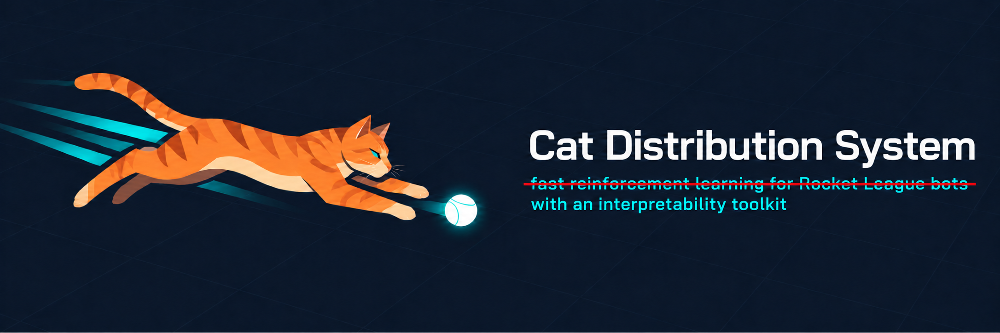
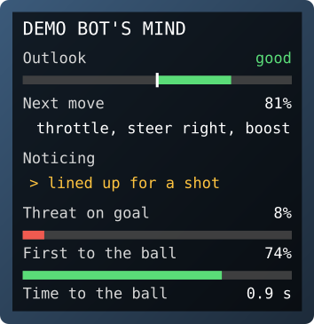

<p align="center">
  
</p>

# CDS-interpret

**See what your Rocket League bot is thinking.**

Your bot's brain is a neural network: thousands of numbers that somehow turn into saves, shots and demos. CDS-interpret
lets you look inside it. You can ask it questions ("does it know the ball is about to go in my goal?"), find the ideas
it has learned on its own, switch one off to see what changes - and watch all of it live, on screen, while it plays.

<p align="center">
  
  <br><sub>The thoughts panel, drawn in the corner of the screen during a match. (Shown here outside the game.)</sub>
</p>

CDS-interpret is the interpretability toolkit from the Cat Distribution System (CDS), published on its own while the
bigger CDS framework is still being finished. It works with **any bot whose brain is a PyTorch network** - one trained
with RLGym (the Python toolkit most Rocket League bots are trained with), rlgym-ppo, a C++ trainer whose network you
can load into PyTorch, or your own code - and shows its thoughts live in RLBot, the framework that runs bots in the
real game. It runs on an ordinary CPU; no GPU needed.

## Try it in five minutes

You need Python 3.11 or newer. The first install also downloads PyTorch, which takes a while; the five minutes start
after that.

```bash
python -m venv .venv
.venv\Scripts\activate            # on macOS / Linux: source .venv/bin/activate
pip install "cds-interpret[rlgym,rlbot]"
cds-interpret demo
```

(On Linux, pip picks PyTorch's GPU build, several GB. For the small CPU build, run
`pip install torch --index-url https://download.pytorch.org/whl/cpu` before the line above.)

The demo takes a tiny built-in bot, records a few games of it in RocketSim (a fast Rocket League simulator), and
looks inside it. In a few minutes you'll see something like this:

```text
Step 2 of 4 - asking every layer questions about the game (probes)
  concept                            layer      score  input  random  measure steady
  Worked out by the network (at least 0.05 better than both):
  ball_dist (distance to the ball)   body.1      0.89  -0.04    0.50  R2      yes
  ...
Step 4 of 4 - switching ideas off to see whether the bot uses them (edits)
  'goal_side' probe direction removed at body.3: the bot's choice changes on 15% of moments (KL 0.125)
  a random direction removed at body.3 (the control; 3 tries): the bot's choice changes on 10% of moments (KL 0.022)
  ...
All done. The full picture - every probe, the features with their moments drawn on the field, the edits - is in
cds-demo\report.html
```

How to read it: each row asks the bot one question, here "how far away is the ball?". **score** is how well its best
layer answers, on games it never learned from (for a number that's R2: 0 is a guess, 1 perfect; for a yes / no
question, AUROC: 0.5 is a guess, 1 perfect). **input** and **random** ask the same question of the bot's raw input and
of a copy of the network with random weights - so 0.89 against -0.04 and 0.50 means the network worked the distance
out for itself. In step 4, **KL** measures how far the bot's choices moved when an idea was switched off (0 is not at
all): removing the "goal side" direction moves them about six times as much as removing a random one.

Open `cds-demo/report.html` in your browser. It shows what the bot knows, the ideas it uses, and moments from its games
drawn from above.

On Python 3.13, leave out `rlgym` (`pip install "cds-interpret[rlbot]"`): RLGym doesn't support 3.13 yet,
so the demo uses random game moments instead of recorded games. Everything else works.

## Then on your own bot

Tell the toolkit three things about your bot: its network, how it builds its input from the game, and its list of
actions.

```python
import cds_interpret as ci

policy = ci.Policy(
    my_network,                       # your torch.nn.Module
    obs=my_obs,                       # my_obs(frames, me): your bot's input, built from the game state
    actions=ci.lookup_table(),        # the controls behind each action number (or your bot's own table)
)
moments = ci.record.rocketsim(policy, games=20, seconds=120)   # watch it play 20 games
study = ci.Study(policy, moments)
print(study.probes().summary())       # what each layer knows
study.report("my-bot.html")           # everything, on one page
```

Don't want to write `my_obs`? Record your bot in the real game instead; the recorder keeps the exact inputs your
network saw. The [quickstart](docs/quickstart.md) walks through both ways, step by step.

## What you can do with it

- **Ask your bot questions.** A *probe* is a small readout that asks the network one question, like "will the ball
  land near me?" or "am I first to the ball?". The toolkit asks dozens of them at every layer, scores the answers on
  games it never trained on, and asks the same of the bot's raw input and of a random copy of the network - so you
  learn what the network *worked out*, not what was already in its input.
- **Find the ideas it uses.** A *sparse autoencoder* is a tool that finds the separate ideas a network uses - one for
  "lined up for a shot", another for "about to lose the ball". The toolkit suggests a name for each idea from the
  game, draws its strongest moments on the field, and keeps your confirmed names in a small names file.
  [Name your bot's features](docs/howto/name-features.md).
- **Check that it really uses them.** Switch an idea off, or turn it up, and see what the bot does differently - on
  recorded moments, or over whole games with a proper error bar.
- **Watch it think, live.** Wrap your RLBot bot in one line and its thoughts appear on screen while it plays: its
  outlook, its next move and how sure it is, what it is noticing, where it thinks the ball will land. It reads your
  network without changing it, so your bot plays exactly the same.
  [Watch it think in RLBot](docs/howto/overlay.md).
- **See why it makes each move, live.** "Why this move" names the ideas pushing the bot toward the move it's about
  to make (and the one pushing against it); "Looking at" shows what that move rests on - its own car, the ball, the
  opponents, the team-mates. [Why this move, and what it's looking at](docs/howto/why-and-looking.md).
- **2v2 and 3v3 too.** Every car gets its own landing ring, and the panel follows the car you watch with the
  spectator camera - or a fixed car, or one picked for the match. [Team modes](docs/howto/team-modes.md).
- **Both teams at once.** The same bot on both sides, or two bots that each show their thoughts: they share one panel,
  which shows whichever car the camera is on and keeps one size, and each team's rings and title take its colour.
  [Both teams](docs/howto/team-modes.md#both-teams-showing-their-thoughts).
- **Watch a bot you can't modify.** A small RLBot script draws the same panel over a bot that runs on its own - a
  compiled bot, one in another language - from its weights and a port of its observation.
  [Thoughts for a bot you can't modify](docs/howto/watch-a-bot.md).
- **Keep your panel as your bot trains.** One command carries a pack's names over to a newer checkpoint, by what the
  features fire on, and refits the rest. [Keep your panel](docs/howto/keep-your-panel.md).
- **Design your own panel.** Pick the rows, names, colours, size and position in a small TOML file, or draw your own
  rows in Python - or take the built-in compact one (`panel="compact"`), the same readings in half the room, for
  watching a match. [Customize the panel](docs/howto/customize-the-panel.md).
- **Record games three ways.** In RocketSim against itself or a scripted opponent, in the real game through RLBot, or
  in your own RLGym environment.
- **See what a decision rests on.** Was it the ball, its own car or the opponent? Which of its ideas tipped it?
  Shapley values - a fair way of splitting credit between things that act together - say, with a score for how far
  to trust the answer.
  [See what a decision rests on](docs/howto/what-decisions-rest-on.md).
- **See what your bot learns between checkpoints.** What each new checkpoint picked up, in its habits and in its
  choices on the same moments; how healthy its layers are; and which situations it should practise next.
  [Follow a bot through training](docs/howto/track-training.md).
- **Check your tools.** Every technique has a quiet way to mislead; the toolkit measures each one - autoencoders
  true to the bot's choices, features that a second run finds again, probes the bot really uses, and panel readings
  whose 40% really means 40%.
  [Check your tools](docs/howto/check-your-tools.md).
- **Share what you find.** Every study becomes one HTML page with charts and field drawings, light and dark.

## Documentation

| | |
|---|---|
| [Quickstart](docs/quickstart.md) | five minutes on the demo bot, then your own |
| [How it works](docs/concepts.md) | the ideas behind it, in plain words |
| [Bring your own bot](docs/howto/bring-your-own-policy.md) | wrapping any network: actor-critics, TorchScript, RLGym observations |
| [Record games](docs/howto/record-moments.md) | RocketSim, the real game, your RLGym env, your own data |
| [Ask questions with probes](docs/howto/probes.md) | probing layers, and probes steady enough to show live |
| [Find the ideas it uses](docs/howto/sae-features.md) | sparse autoencoders and their features |
| [Name your bot's features](docs/howto/name-features.md) | from numbers to names you trust, end to end |
| [Test what it relies on](docs/howto/causal-tests.md) | switching ideas off and up, in moments and in games |
| [See what a decision rests on](docs/howto/what-decisions-rest-on.md) | the ball, its car, the opponents; and what each feature does |
| [Check your tools](docs/howto/check-your-tools.md) | how to tell when a technique is misleading you |
| [Watch it think in RLBot](docs/howto/overlay.md) | the live thoughts overlay |
| [Why this move, and what it's looking at](docs/howto/why-and-looking.md) | the panel's two rows about each decision: how to read them, what they cost |
| [Team modes](docs/howto/team-modes.md) | 2v2 and 3v3: a ring for every car, a panel that follows the camera; both teams' thoughts in one panel |
| [Thoughts for a bot you can't modify](docs/howto/watch-a-bot.md) | a display-only script over a bot that runs on its own |
| [Keep your panel when your bot trains on](docs/howto/keep-your-panel.md) | a pack carried over to a newer checkpoint, in one command |
| [Customize the panel](docs/howto/customize-the-panel.md) | every option of the panel's TOML file, and Python hooks |
| [Reports and drawings](docs/howto/figures.md) | the HTML page, its sections, the drawings |
| [See what it learns between checkpoints](docs/howto/track-training.md) | checkpoint after checkpoint, and what to practise next |
| [Labels](docs/labels.md) | every game-state fact the toolkit works out, and adding your own |
| [Coming from rlgym-ppo or GigaLearn](docs/coming-from.md) | where the things you know fit |
| [API reference](docs/api.md) | every function and class |
| [When something goes wrong](docs/troubleshooting.md) | error messages and what to do |

## Contributing

New techniques, labels, recorders, fixes and docs are all welcome. [CONTRIBUTING.md](CONTRIBUTING.md) explains where
new things slot in. Changes are listed in [CHANGELOG.md](CHANGELOG.md).

## License

MIT - see [LICENSE](LICENSE). The libraries it uses keep their own licenses: see [THIRD_PARTY.md](THIRD_PARTY.md).
Rocket League is a trademark of Psyonix. This project is not affiliated with Psyonix, Epic Games, RLBot or RLGym.
