# See what each attention head looks at

<p align="center">
  
  <br><sub>The attention demo bot's four heads. Each little square map is one head: the rows are the token doing the
  looking, the columns the token it looks at, the numbers the percent of its attention.</sub>
</p>

More and more bots read the game through **attention**: the network turns its own car, the ball, its team-mates and
its opponents into one *token* each, and a small transformer lets every token ask the others what they hold. Each
**head** of the transformer decides, at every decision, how much each token listens to each other one.

This tool shows those weights, head by head and by name: what each head looks at on average over recorded games, how
spread out it is, and how that changes with the situation - at kickoffs, with the ball in the air, with an opponent
close, when defending. It ends with a sentence per head, like *"L2 H2 watches the ball (55% of its attention); more so
at kickoffs (+25 points)"*.

## Try it in five minutes

```bash
cds-interpret attention --demo
```

The attention demo bot is the tiny demo bot again, rebuilt with an attention block: its 30 inputs are cut into three
tokens - its own car, the ball, the opponent - and two transformer layers of two heads each let them look at each
other. The command records 12 short games of it in RocketSim (random game moments if RocketSim isn't installed) and
reads its heads. In half a minute you'll see something like this:

```text
  head     looks at                                     spread  where it shifts most
  --------------------------------------------------------------------------------------------------------
  L1 H1    own car 56%, ball 36%, opponent 9%             0.53  ball in our half (+13 own car), goal side (+12 ball)
  L1 H2    ball 34%, own car 34%, opponent 33%            0.42  goal side (-46 own car), kickoff (-26 own car)
  L2 H1    own car 56%, ball 26%, opponent 18%            0.49  goal side (+44 own car), kickoff (+37 own car)
  L2 H2    ball 55%, own car 24%, opponent 21%            0.64  goal side (-28 opponent), kickoff (+25 ball)

In words (a starting point - check it against the maps):
  L1 H1 watches its own car (56% of its attention); more so when the ball is in its own half (+13 points), ...
  L1 H2 looks at one token at a time and switches between them: the ball most (34%), then its own car (34%); ...
  L2 H2 watches the ball (55% of its attention); looks less at the opponent when it is goal side of the ball
  (-28 points), and more so at kickoffs (+25 points).
```

How to read it: **L1 H2** is layer 1, head 2 (layers are numbered in the order the network runs them). **looks at**
is the share of the head's attention each token gets, averaged over every token doing the looking and every moment.
**spread** says how the head spends its attention at a single moment: 0 is all of it on one token, 1 is even over the
tokens there. **where it shifts most** names the situations where the head's attention moves furthest, with the token
whose share changes most, in **points** (percentage points: 55% to 80% is +25 points).

Open `cds-attention/attention.html` in your browser for the whole picture: the map of every head (the picture at the
top of this page), the chart of shifts by situation, and a chart per big shift showing every token's change.

## How the shifts are worked out

For each situation the toolkit compares the moments where it holds with the moments where it doesn't: the head's
share for each token here, minus there. A shift only counts as **steady** when it holds across games - its 95%
interval, from resampling whole games, leaves 0 out - and is at least 3 points; the rest are left blank, and never
make it into a sentence.

The situations come from the game state and the labels of each moment: **kickoff**; **ball in the air** (above 300
uu); **ball in our half** (defending); **opponent close** (within 1,000 uu); **ball close** (within 800 uu); **low
boost** (under 20); and every yes / no label - in the air, on a wall, threat on goal, shot on target, demo chance,
first to the ball, goal side, last back, supersonic, about to touch, about to score or concede, and your own
[registered labels](../labels.md). Every situation but kickoff is compared within open play, so a kickoff's own
pattern can't pass for, say, "the ball on the ground". A situation with fewer than 50 moments or 3 games on a side
is listed as not compared.

## On your own bot

```python
import cds_interpret as ci

study = ci.Study(policy, moments, layers=[])          # layers=[]: no probes needed for this
maps = study.attention(tokens=["own car", "ball", "opponent"])
print(maps.summary())
study.report("attention.html")                        # the page, with the attention section
```

Or from the command line, with a recording of your bot and a function that returns its `ci.Policy`:

```bash
cds-interpret attention recordings/my-bot --policy my_bot:policy --tokens "own car,ball,opponent"
```

It writes `attention.html`, every figure as an `.svg`, and `attention.json` (every number: each head's full map, its
focus, spread and shifts, with intervals). `--query "own car"` reads only the own car's row (useful when the network
decides from that token alone); `--critic` reads the critic's attention instead (the policy's `value` function);
`--max-moments 50000` studies a random part of a big recording.

Without `sites`, every attention module the network runs is found and read: `nn.MultiheadAttention`,
`nn.TransformerEncoderLayer` (even on its fast path, which skips its attention module), the attention inside
`nn.TransformerDecoderLayer`, and modules of your own that say how (next section). A critic's attention, never run
by the policy, is skipped - pass `forward=policy.value_fn` to read it.

## Your own attention module

Fast attention kernels (`F.scaled_dot_product_attention`, flash attention, fused kernels) never hand the attention
weights out. So the toolkit doesn't ask for them: a hook captures what goes *into* each attention module, and the
weights are worked out again from the module's own query and key projections - softmax(Q K^T / sqrt(d)) per head, in
float32. Your network runs exactly as it always does. You tell the toolkit how, in one of three ways.

**Name its parts.** For the usual pre-norm block with one packed `qkv` layer and a padding mask:

```python
from cds_interpret import attention as AT

read = AT.recompute(qkv="qkv", heads=4, norm="ln1", keep="valid")
sites = {"L1": AT.Site("encoder.blocks.0", read), "L2": AT.Site("encoder.blocks.1", read)}
maps = study.attention(sites=sites, tokens=["own car", "ball", "mate", "opp 1", "opp 2"])
```

`qkv` is the layer that makes queries, keys and values (in that order, as `nn.MultiheadAttention` packs them;
`layout="heads"` when yours is per head), or `q="q_proj", k="k_proj"` for separate ones. `heads` is a number or the
attribute that holds it. `norm` is what the input goes through first. `keep` names the forward argument holding the
mask, True where a token may be looked at (`masked=` for the opposite convention).

**Or give it a method.** A module with `attention_probs(...)`, taking what its `forward` takes and returning
[batch, heads, queries, keys], is found and read on its own:

```python
class MyBlock(torch.nn.Module):
    def attention_probs(self, x, valid):
        h = self.qkv(self.ln1(x))
        return AT.softmax_attention(h[..., :64], h[..., 64:128], heads=4, keep=valid)
```

**Or pass any function** `fn(module, args, kwargs) -> [batch, heads, queries, keys]` as `AT.Site(path, probs=fn)`.
`AT.register_attention(MyBlock, fn)` makes it the default for every module of that class.

**Check that you've got the right numbers.** Rebuild the block's output from the probabilities - attention times
values, then the block's output projection - and compare it with what the block really returned. On a large bot's
entity-attention block they matched to within 0.00002. `tests/test_attention.py` does exactly this check on a small block.

For a single batch, `AT.probs(net, x)` returns `{layer: [N, heads, queries, keys]}` - the raw probabilities, for
your own analyses.

## Tokens whose order changes

A set of cars often has no fixed order: slot 3 is an opponent in one game and a team-mate in the next, or absent. Give
the tokens **roles** instead of names, from the network's own input:

```python
def roles(x):                          # x [N, D], the network's input -> [N, 7]: each token's role, -1 when absent
    cars = x[:, 120:].reshape(len(x), 5, 30).numpy()
    present, mate = cars[..., 0] > 0.5, cars[..., 1] > 0.5
    car_roles = np.where(present, np.where(mate, 2, 3), -1)
    return np.concatenate([np.zeros((len(x), 1)), np.ones((len(x), 1)), car_roles], 1)

maps = study.attention(tokens=AT.Tokens(["own car", "ball", "team-mates", "opponents"], roles=roles))
```

The attention to every token of a role is added up ("opponents" is the attention to all opponents together) and the
rows of the tokens of a role are averaged. Tokens the network masks out get no attention and are left out. Number
roles nearest first ("opponent 1", "opponent 2") to tell the opponents apart, and study one mode (1v1, 2v2, 3v3) at a
time.

## Reading it well

- **Looking is not using.** A head can look at a token without the decision resting on it. The demo bot's heads give
  the opponent up to a third of their attention, yet `study.attribution()` puts the opponent's share of its decisions
  at half a percent - the scripted player it copied never looks at the opponent. Test what matters with edits and
  [what decisions rest on](what-decisions-rest-on.md).
- **A head that spreads evenly everywhere may be doing nothing.** If every head has a spread near 1, the attention is
  averaging the tokens - check whether the network reads the block at all. On a large self-play bot that got an
  entity-attention block late in its training, the maps showed it in a few minutes: the policy's eight heads were still
  almost even billions of steps later (replacing their output with its average changed about 1% of its choices),
  while its critic's watched the ball.
- **"In words" is a starting point,** like a feature's suggested name: check it against the maps.
- **Random moments are for trying the tool,** not for findings: record real games.

## The pieces

`cds_interpret.attention`: `probs`, `iter_probs`, `AttentionTap` (the hooks), `find_sites`, `Site`, `recompute`,
`softmax_attention`, `mha_probs`, `encoder_layer_probs`, `register_attention`, `Tokens`, `aggregate`, `measure`,
`situations`, `Situation`, `shift_stats`, `AttentionMaps` (`mean`, `focus_mean`, `table`, `top_shifts`, `describe`,
`summary`, `to_dict`, `save`) and `figures`. See the [API reference](../api.md#attention-heads).
