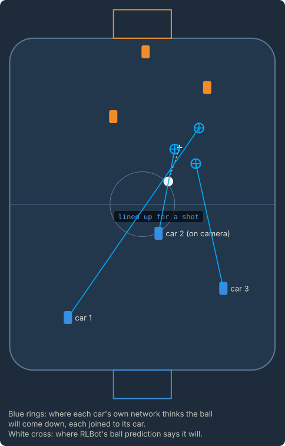
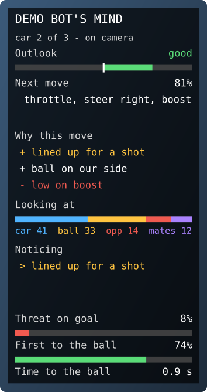

# Team modes: whose thoughts the panel shows

In 2v2 and 3v3 your bot drives two or three cars at once. The overlay draws a landing ring for **every** one of them,
and **one** panel - for the car you're watching.

<p align="center">
  
  &nbsp;&nbsp;
  
</p>

On the left, a 3v3 moment seen from above: each of the bot's cars has its own blue ring where *its* network thinks
the ball will come down, joined to it by a line. On the right, the panel: you're watching car 2, so it shows car 2's
thoughts, and the line under the title says so.

## The five-minute version

There's nothing to set up. If the overlay already works for your bot in 1v1, it works in 2v2 and 3v3:

1. Start a 2v2 or 3v3 match with your bot on a team - two or three copies of it from the same `bot.toml`, or a
   [Hivemind](#hiveminds-and-one-copy-per-car).
2. With RLBot's rendering on, follow one of your bot's cars with the spectator camera.
3. The panel shows that car's thoughts, and says `car 2 of 3 - on camera`. Follow another of your cars and the panel
   follows it. Move the camera to an opponent, or to the free camera, and the panel stays on the last of your cars you
   watched: `car 2 of 3 - last on camera`.

The word floating above a car - the idea driving its move - marks the car the panel is about, in its team's colour
(`[colors] team_blue` / `team_orange`, or one colour for it with `[markers] car_label_color`).

Every car keeps its own smoothing and its own "noticing" list, so when the panel switches cars you see the new car's
numbers straight away, never a blend of the two.

## Choosing whose thoughts: `follow`

The panel goes down a list of rules and uses the first one that gives one of your bot's cars:

```toml
[panel]
follow = ["camera", "last", "random"]     # the default
```

| rule | gives |
|---|---|
| `"camera"` | the car the host's camera follows, when it's one of yours |
| `"last"` | the last of your cars the camera followed this match |
| `"random"` | one of your cars, picked when the match starts and kept for the whole match |
| `"first"` | your first car (the one with the lowest player number) |
| `2` | your second car - any number works, 1 is the first |
| `"hide"` | no panel at all |

So the default reads: *the car I'm watching; if I'm not watching one of the bot's cars, the last one I watched; if I
haven't watched any yet, one picked at random*. If no rule gives a car, the panel shows your first car.

A few other choices:

```toml
follow = [1]                   # always car 1, wherever the camera is
follow = ["camera", "hide"]    # thoughts only while you're watching one of the bot's cars
follow = ["camera", "first"]   # the car on camera, else car 1 (no random pick)
```

`"random"` picks the same car in every copy of your bot (they all work it out from the same numbers RLBot gives the
match), and usually a different one next match.

## Choosing whose rings: `landing_for`

```toml
[markers]
landing_for = "all"            # the default
```

| value | rings for |
|---|---|
| `"all"` | every car of your bot |
| `"panel"` | only the car the panel shows |
| `"camera"` | only the car on camera, when it's one of yours (none otherwise) |
| `"none"` | no car |
| `[1, 3]` | your cars 1 and 3 |

`landing = false` still turns every ring off, whatever `landing_for` says. Each ring is smoothed on its own and joined
to its own car (`landing_line = false` drops the lines).

## The line under the title: `subtitle`

```toml
[panel]
subtitle = "car {car} of {cars} - {rule}"    # the default; "" for no line
```

It appears only when your bot has more than one car. It can say:

| | |
|---|---|
| `{car}` | the car's number among your bot's cars (1 = the first) |
| `{cars}` | how many cars your bot has |
| `{rule}` | why this car: "on camera", "last on camera", "picked for this match", "first car", "fixed" |
| `{name}` | the player's name in the game, e.g. "MyBot (2)" |

For example `subtitle = "{name} ({rule})"` gives `MyBot (2) (on camera)`.

## What RLBot can and can't tell the overlay

The overlay doesn't see your screen. RLBot gives every bot exactly one number about the camera,
`last_spectated`: **the player the host's spectator camera followed most recently**. That has a few honest
consequences:

- **"On camera now" and "on camera last" are the same number.** When you switch to the free camera, the ball camera
  or the overhead view, the number doesn't change - so the panel keeps showing the car you last followed. That's
  usually what you want. It's also why the rules `"camera"` and `"last"` only differ when the camera moves to a car
  that *isn't* your bot's: `"camera"` then has no answer, and `"last"` keeps the last of yours.
- **Before you've followed anyone, the number is 0** - the first player of the match. RLBot can't tell "player 0"
  from "nobody yet", so if your bot has player 0, the panel starts on that car and says "on camera".
- **It's the host's camera.** The player hosting the match is the one whose spectator camera counts; someone
  watching a stream of it doesn't change anything.
- **If you play in the match yourself**, you aren't spectating, so the number doesn't follow your view. Use a fixed
  rule, such as `follow = [1]` or `follow = ["random"]`.

## Hiveminds and one copy per car

RLBot runs a bot in one of two ways, and the overlay handles both:

- **One copy per car** (a plain `Bot`, the usual way). Each copy controls one car and has only that car's network
  readings. Every copy reads the same packet, so they all work out the same panel car without talking to each other:
  the copy driving that car draws the panel, and each copy draws its own ring. "Your bot's cars" are the cars of your
  team that run the same bot - the same agent id from the same `bot.toml`. Start every copy from the same `bot.toml`;
  a team-mate that is another bot, or a person, isn't one of yours and never gets the panel.
- **A Hivemind** (one process drives all of its cars). The overlay reads all its cars from its network and matches
  the rows to its `indices` in order. Run the network on its cars in that order - all of them in one call, or one call
  each - and every car's ring and the panel come from the right car.

## What it costs

Nothing extra for your bot's decisions: the overlay still only listens to your network with read-only hooks and does
its work after your controls are sent. The helper process reads every car (a few dot products each) and draws a ring
per car; the heavier readings - [why this move and looking at](why-and-looking.md) - run for the panel's car only.

## When something looks wrong

**Two panels on top of each other.** The copies don't recognise each other as the same bot, so each thinks it is the
only one. Start them all from the same `bot.toml` (the same agent id) - the example folder has two (`bot.toml` and
`thoughts.bot.toml`), and they count as two different bots.

**The panel shows a car I haven't picked.** Either you haven't followed any car yet (RLBot says player 0, see above),
or you're on the free camera after following that car. Follow the car you want once.

**A car has no ring.** Check `landing_for`, and that the pack has a landing readout at all (`make_pack` adds one when
the ball's landing point varied enough in its games).

**A Hivemind's panel shows the wrong car's thoughts.** Its network runs on its cars in another order than `indices`,
or only on some of them each tick. The bot's log says so once if the number of rows and cars differ.

More in [the overlay guide](overlay.md) and [designing your own panel](customize-the-panel.md).
